# 凤霄·九玄——广州大学RoboMaster2027赛季常规哨兵代码完全版
这是一个庆园阁战队RoboMaster2027赛季的自动哨兵电控完整代码，记得使用CLion打开哦~

## 0. 遥控器的使用方法

这个我必须写在最前面！太多人（包括以前的我）都不会使用遥控器，结果后来遥控器摇杆中值发生了明显偏移。

### 0.0 说明一下

错误的手法：拨动摇杆的时候甩手（指的是手指推动摇杆后松手让摇杆弹力回中），

正确的手法：手指全程不离开摇杆，像推杆时一样，主动、匀速地把它带回来。

如果你使用错误的手法使用遥控器摇杆，那么每次松手都是一次冲击载荷砸在机械限位和电位器/霍尔上。摇杆帽松动、电位器磨损加快、中值漂移，基本都是这么来的。

使用遥控器的宝子一定要严肃注意！！！

说完手法，再说一下遥控器的通道映射：

说在最前面，新赛季九玄的控制逻辑可能有点绕，请操作手在线阅读！！！

首先这个赛季的九玄的遥控器有16个通道，我将其映射成了：左摇杆x，左摇杆y，右摇杆x，右摇杆y，SA、SB、SC、SD、SE、SG三档位拨杆和SF和SH二档位拨杆，遥控器前双旋扭和遥控器后双推杆。

### 0.1 SA拨杆

SA拨杆如图所示：

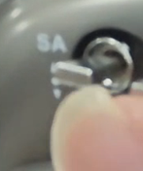

SA有上中下三档：

上档：静默模式，在此模式无法进一步选择九玄工作模式；

中档：自由模式，在此模式下九玄不会向小电脑发送比赛信息，便于九玄日常调试；

下档：战争模式，在此模式下九玄会向小电脑发送比赛信息，同时在比赛开始之前，无论摄像头是否识别到目标亦或是导航节点是否要让九玄走，九玄都不会用小电脑的信息直到比赛开始。

### 0.2 SB拨杆

SB拨杆如图所示：

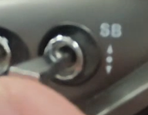

SB有上中下三档：

上档：静默模式，在此模式无法进一步选择九玄工作模式；

中档：步兵模式，此模式下可以将九玄视为步兵机器人，需注意此模式下导航数据无效。

下档：哨兵模式，此模式下可以将九玄视为哨兵机器人。

注意：SB拨杆的信息只有在SA拨杆在中档和下档的时候才有效，其他时候无效。

### 0.3 SC拨杆

SC拨杆如图所示：

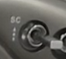

SC有上中下三档：

上档：静默模式，在此模式无法控制九玄；

中档：遥控器模式，在此模式下可以使用遥控器控制九玄，无法使用RoboMaster操作手软件控制九玄。

下档：RoboMaster操作手模式，在此模式下可以使用RoboMaster操作手软件控制九玄，无法使用遥控器控制九玄。

注意：SC拨杆的信息只有在SB拨杆在中档和下档的时候才有效，其他时候无效。

### 0.4 SF拨杆

SF拨杆如图所示：

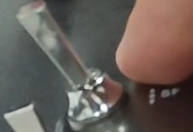

SF有上下二档：

上档（远离遥控手侧）：不开启摩擦轮；

下档（靠近遥控手侧）：开启摩擦轮。

注意：SF拨杆的信息只有在SC拨杆在中档的时候才有效，其他时候无效。

### 0.5 SD拨杆

SD拨杆如图所示：

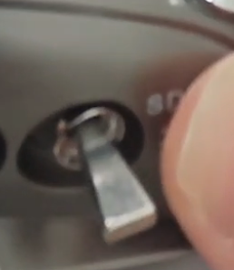

SD有上中下三档：

上档：静默模式，在此模式下九玄无法开火；

中档：半自动模式，在此模式下九玄单发开火。

下档：全自动模式，在此模式下九玄连发开火。

注意：SD拨杆的信息只有在开启摩擦轮的时候才有效，其他时候无效。

### 0.6 SH拨杆

SH拨杆如图所示：

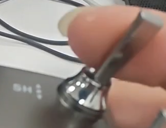

SF有上下二档：

上档（远离遥控手侧）：不开火（拨弹轮不动）；

下档（靠近遥控手侧）：开火（拨弹轮按照SD的开火模式运动）。

注意：SH拨杆的信息只有在开启摩擦轮的时候才有效，其他时候无效。

（SE拨杆和SG拨杆涉及到语音模块，这个模块还没开发，以后有展示的时候才用的，我今年要把九玄代码写的美美的！！！）

### 0.7 摇杆区

左摇杆区如图所示：

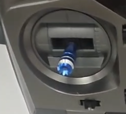

控制九玄的底盘运动，今年的九玄底盘前进方向是以云台方向为基准的！

注意：左摇杆的数据只有在SC拨杆在中档的时候才有效，其他时候无效。

右摇杆区如图所示：

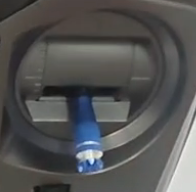

控制九玄的云台的运动，上下控制九玄的绝对角度，左右控制九玄往哪个方向每一刻转动多少度。

注意：右摇杆的数据只有在SC拨杆在中档的时候才有效，其他时候无效。

### 0.8 后双推杆区

左后推杆区如图所示：

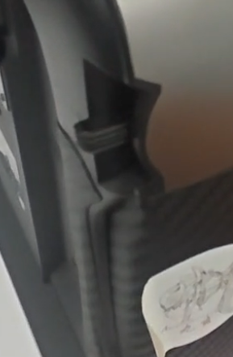

这个图片的推杆位置就是中位，表示不开启小陀螺，往上推就是往一个方向小陀螺x角速度（x的值取决于向上推的程度），往下推反之。

注意：左后推杆区的数据只有在SC拨杆在中档的时候才有效，其他时候无效。

右后推杆区如图所示：

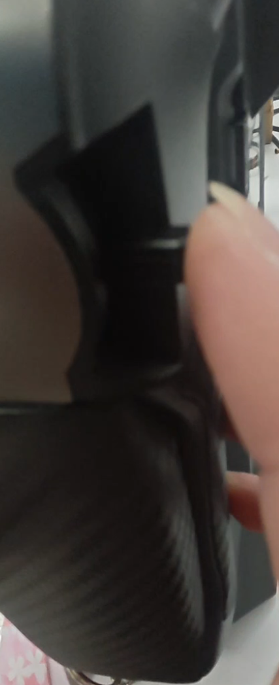

这个推杆的作用是控制九玄遥控模式下全自动开火模式下的拨弹轮转速，越往下越低越往上越高。

注意：右后推杆区的数据只有在SC拨杆在中档的时候才有效，其他时候无效。

### 0.9 遥控器前双旋扭区

左旋扭如图所示：

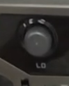

左旋扭控制的是九玄遥控器模式下底盘线速度上限，逆时针旋转增加上限，顺时针反之。

注意：左旋扭的数据只有在SC拨杆在中档的时候才有效，其他时候无效。

右旋扭如图所示：

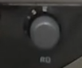

左旋扭控制的是九玄遥控器模式下云台yaw轴灵敏度，逆时针旋转增加灵敏度，顺时针反之。

注意：右旋扭的数据只有在SC拨杆在中档的时候才有效，其他时候无效。

以上是目前凤霄·九玄的遥控器逻辑说明。

## 1. 代码框架讲解

hhh，等我打完RMUL2027再说吧……（其实是还没定稿）
